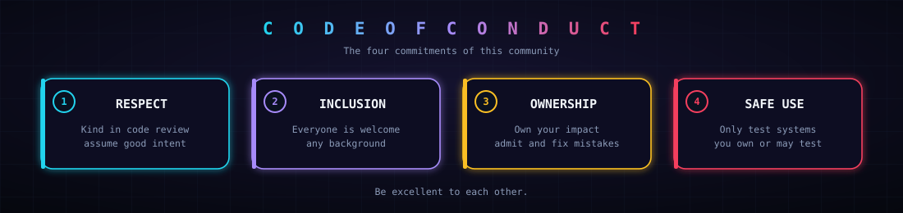

# 🌍 Code of Conduct

## Our pledge

We want AEGIS to be a welcoming, harassment-free project for everyone, regardless of experience, background, identity or nationality.

## ✅ and ❌

| ✅ Expected | ❌ Unacceptable |
|---|---|
| Be respectful and constructive, especially in code review | Harassment, insults, discrimination or personal attacks |
| Assume good intent and ask before judging | Trolling, spam or deliberately disruptive behavior |
| Give and accept feedback gracefully | Publishing others' private information without permission |
| Focus on what is best for the project | Using AEGIS to attack systems you do not own or have permission to test |

> [!CAUTION]
> AEGIS is a security tool. Use it only on systems you own or are explicitly authorized to test.

## ⚖️ Enforcement

Maintainers may edit or remove comments, commits, issues and contributions that violate this code, and may temporarily or permanently ban contributors for harmful behavior.

## 📨 Reporting

Report violations privately to the maintainer through GitHub: [@achh-914](https://github.com/achh-914). All reports are reviewed and handled confidentially.

## 🙏 Attribution

Inspired by the [Contributor Covenant](https://www.contributor-covenant.org/).
