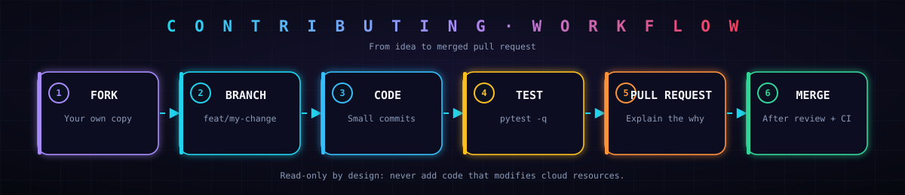

# 🤝 Contributing to AEGIS

Thanks for your interest! AEGIS is in early development and contributions of every size are welcome.

## 💡 Ways to contribute

| Area | Examples |
|---|---|
| 🐛 Bugs | Report a wrong finding or a crash with a minimal snapshot |
| 📜 Rules | Add a detection rule (cross-account trust, wildcard policies, ...) |
| 🧪 Fixtures | Add a synthetic example that follows the real AWS format |
| 🧠 Engine | Improve the policy evaluation or the graph builder |
| 📖 Docs | Clarify the README, examples and limitations |

## 🚀 Getting started

    git clone https://github.com/achh-914/AEGIS.git
    cd AEGIS
    python3 -m venv .venv && source .venv/bin/activate
    pip install -e . pytest
    pytest -q

## 🔁 Workflow

1. Fork the repository and create a branch: `git checkout -b feat/my-change`
2. Make small, focused commits.
3. Add or update tests for your change.
4. Run `pytest -q` and make sure everything passes.
5. Open a pull request and explain **why** the change is needed.

## ✍️ Commit messages

| Prefix | Use for |
|---|---|
| `feat:` | A new capability or rule |
| `fix:` | A bug fix |
| `docs:` | Documentation only |
| `test:` | Tests and fixtures |
| `ci:` | Workflows |
| `chore:` | Maintenance |

## 📏 Ground rules

> [!IMPORTANT]
> AEGIS is **read-only by design**. Never add code that modifies cloud resources.

> [!WARNING]
> **Never commit** real credentials, account IDs or customer snapshots. Use anonymized, synthetic data only.

- Every rule needs a test, and a fixture that shows it firing.
- Keep claims honest: if something is not validated on a real account, say so.
- Document new rules in the README rules table.

## 🔒 Security issues

Do not open public issues for vulnerabilities. See [SECURITY.md](SECURITY.md).

By contributing you agree to follow our [Code of Conduct](CODE_OF_CONDUCT.md).
