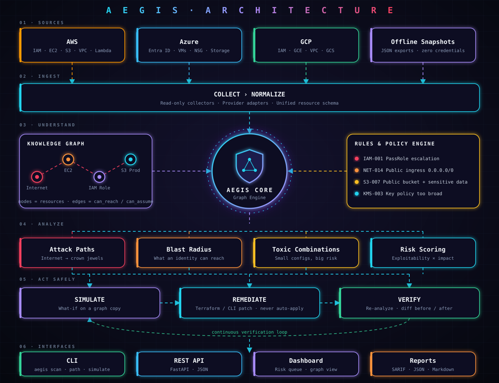
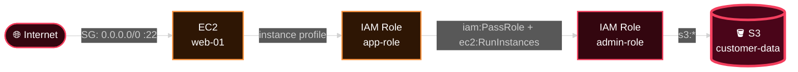

<div align="center">

```text
 █████╗ ███████╗ ██████╗ ██╗███████╗
██╔══██╗██╔════╝██╔════╝ ██║██╔════╝
███████║█████╗  ██║  ███╗██║███████╗
██╔══██║██╔══╝  ██║   ██║██║╚════██║
██║  ██║███████╗╚██████╔╝██║███████║
╚═╝  ╚═╝╚══════╝ ╚═════╝ ╚═╝╚══════╝
```

### Multi-cloud Security Intelligence & Infrastructure Analysis Platform

**Not another scanner. A system that understands how your cloud connects, and how small misconfigurations chain into big breaches.**


</div>

---

## ⚡ Why AEGIS

Scanners give you a flat list of findings. Attackers don't think in lists, they think in **paths**.

AEGIS models your infrastructure as a **graph** (resources are nodes, trust and reachability are edges), then reasons over it:

| | Capability | Question it answers |
|---|---|---|
| 🧠 | **Understand** | How is everything actually connected? |
| 🎯 | **Attack paths** | Can the internet reach my crown jewels, and how? |
| 💥 | **Blast radius** | If this identity is compromised, what falls? |
| 🔮 | **Simulate** | What happens if I change this rule? |
| 🛠️ | **Remediate** | What is the safest fix? (patch generated, never auto-applied) |
| ✅ | **Verify** | Did the fix close the path without breaking anything? |

---

## 🏗️ Architecture

<p align="center">
  
</p>

---

## 🎯 Example: how small things become a breach



Individually each setting looks "medium". Together: **critical**. That is what AEGIS is built to see.

---

## 💻 Terminal preview

```diff
$ aegis scan --provider aws --snapshot ./snapshots/prod.json
+ ✔ Loaded 1,284 resources · 3,911 relationships
+ ✔ Graph built in 0.8s

$ aegis paths --from internet --to s3:customer-data
- ✖ CRITICAL  1 attack path found (4 hops)
-   internet → ec2:web-01 → role:app-role → role:admin-role → s3:customer-data

$ aegis simulate --change "sg-0a1b: remove 0.0.0.0/0 on :22"
! ⚠ Paths closed: 1   Paths opened: 0   Services impacted: 0

$ aegis fix --path 1 --format terraform > fix.tf
+ ✔ Patch generated (not applied)

$ aegis verify --after ./snapshots/prod-after.json
+ ✔ Attack path closed · no regressions
```

> paths, blast and simulate are implemented. fix and verify are on the roadmap, so their output above is the target UX.

---

## 🚀 Quick start

```bash
git clone https://github.com/achh-914/AEGIS.git
cd AEGIS
python3 -m venv .venv && source .venv/bin/activate
pip install -e .

# 1. Find attack paths from the internet to a sensitive bucket
aegis paths --snapshot examples/aws_breach_demo.json --to s3:customer-data

# 2. What falls if this role is compromised?
aegis blast --snapshot examples/aws_breach_demo.json --from role:app-role

# 3. What-if: remove SSH exposure, on a copy of the graph
aegis simulate --snapshot examples/aws_breach_demo.json --remove-ingress sg-0a1b:22
```

Run the tests with pytest -q.

---

## 🧱 Design principles

- **Read-only by default.** AEGIS never mutates your cloud. Fixes are generated as patches you review.
- **Offline first.** Works from JSON snapshots, so no credentials are needed to analyze.
- **Graph over lists.** Risk is a property of relationships, not of single resources.
- **Verify, don't assume.** Every fix is re-analyzed and diffed.

## 🗺️ Roadmap

- [x] Graph model + JSON snapshot loader (demo format)
- [x] Attack path engine (first reference path, with tests)
- [x] Blast radius analysis
- [x] Change simulation on graph copies
- [x] CI: tests on Python 3.11 / 3.12 / 3.13
- [ ] Loader for real AWS exports (get-account-authorization-details)
- [x] Automatic scan with rule tags (OPEN-INGRESS, PRIVESC-PASSROLE, OPEN-TRUST, PUBLIC-BUCKET)
- [ ] More rules (cross-account trust, wildcard IAM policies, unencrypted storage)
- [ ] Risk scoring
- [ ] Terraform / CLI remediation generator
- [ ] Verification & before/after diff
- [ ] Azure and GCP adapters
- [ ] REST API + dashboard

## 🤝 Contributing

See [CONTRIBUTING.md](CONTRIBUTING.md), [CODE_OF_CONDUCT.md](CODE_OF_CONDUCT.md) and [SECURITY.md](SECURITY.md).

## 📄 License

See [LICENSE](LICENSE).
