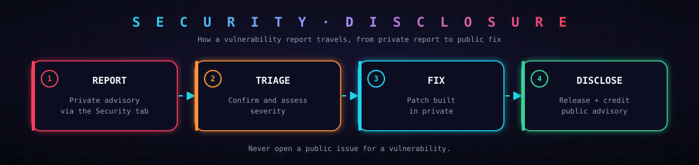

# 🛡️ Security Policy

AEGIS is a security tool, so vulnerabilities in the project itself are taken seriously.

> [!IMPORTANT]
> **Do not open a public issue for a vulnerability.** Use the private reporting flow below.

## 📦 Supported versions

| Version | Supported |
|---|---|
| `main` (latest commit) | ✅ Security fixes |
| `v0.1.x` | ✅ Best effort |
| Older | ❌ |

## 📨 How to report

1. Open the **Security** tab of this repository.
2. Click **Report a vulnerability** to create a private advisory.
3. Include a clear description, steps to reproduce and the potential impact.

## ⏱️ What to expect

| Step | What happens |
|---|---|
| 🔴 Report | You send a private advisory |
| 🟠 Triage | We confirm the issue and assess its severity |
| 🔵 Fix | A patch is prepared privately |
| 🟢 Disclose | Release, public advisory and credit if you wish |

Acknowledgement usually comes within a few days. This is a small open source project, so timelines are best effort.

## 🎯 Scope

| In scope | Out of scope |
|---|---|
| AEGIS source code | Weaknesses in cloud providers |
| Parsing of snapshots and exports | Infrastructure you analyze with AEGIS |
| Report generation | Issues that need a compromised local machine |
| Generated remediation patches | Social engineering |

## 🔐 Handling sensitive data

> [!WARNING]
> Cloud exports can contain account IDs, role names and policies. **Never share real snapshots or credentials** in issues, pull requests or advisories. Anonymize them first.

AEGIS is **read-only by design**: it never modifies your cloud, and generated fixes are patches you review and apply yourself.
