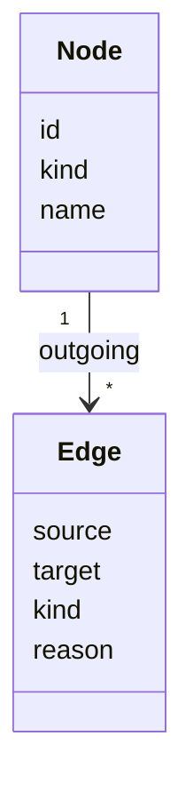

# 006: Infrastructure knowledge graph

Status: Current (field names are indicative, see the source code)

Example node kinds: iam_role, s3_bucket, external_account.
Example edge kinds: can_reach, can_assume. Each edge carries a reason.
