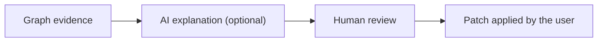

# 007: AI remediation workflow

Status: PLANNED (not implemented, see ADR-0006)

AI would only explain evidence the graph already contains.
It would never change findings or apply changes by itself.
